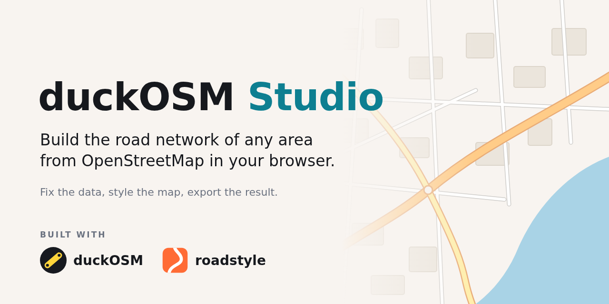
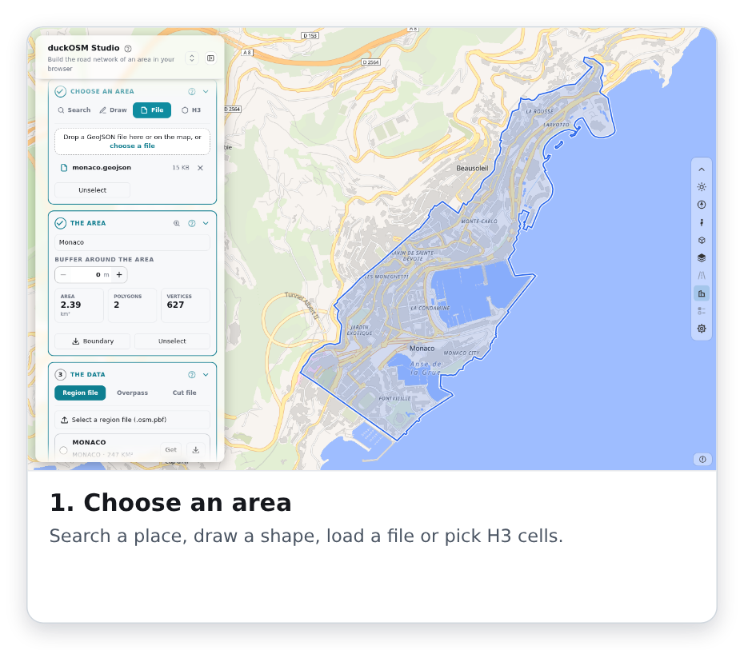
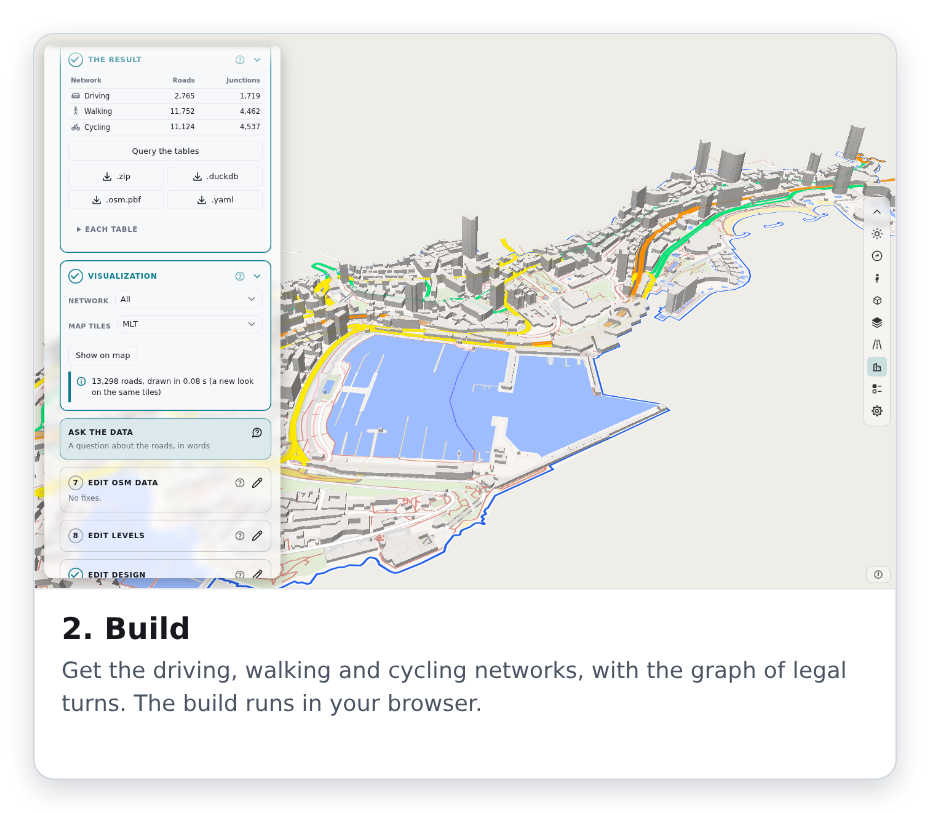
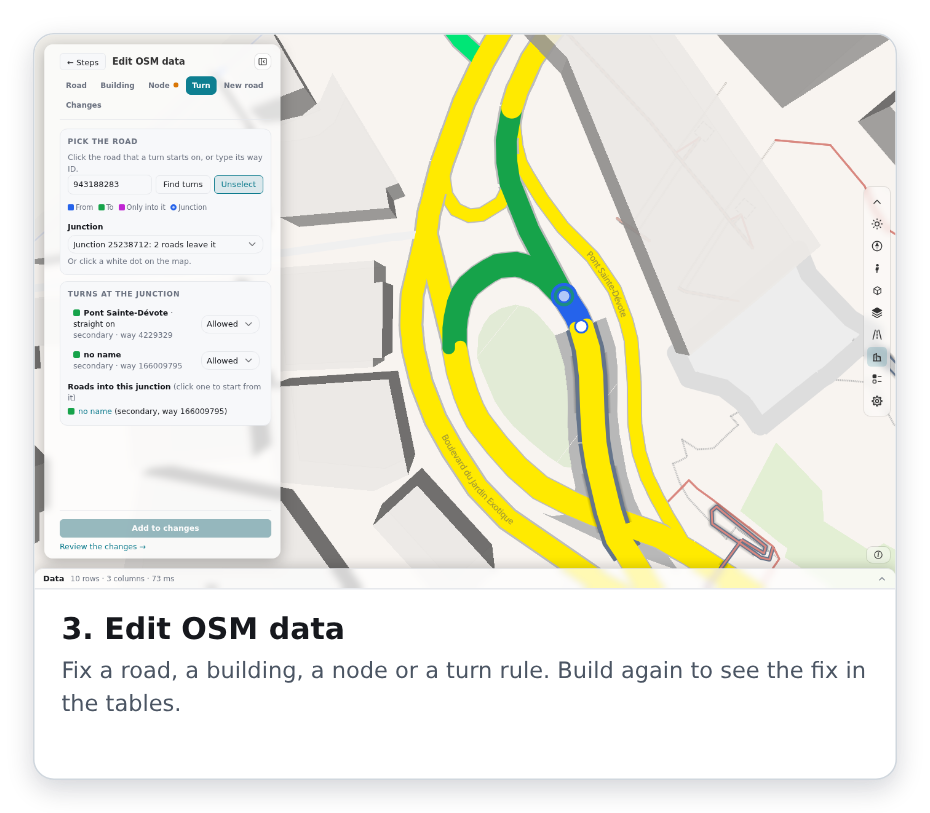
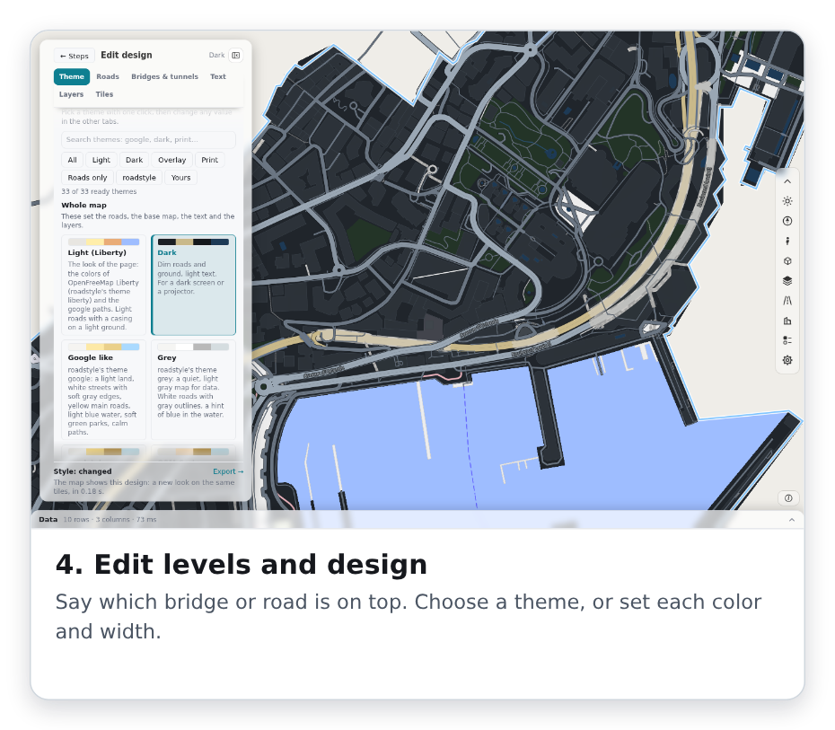
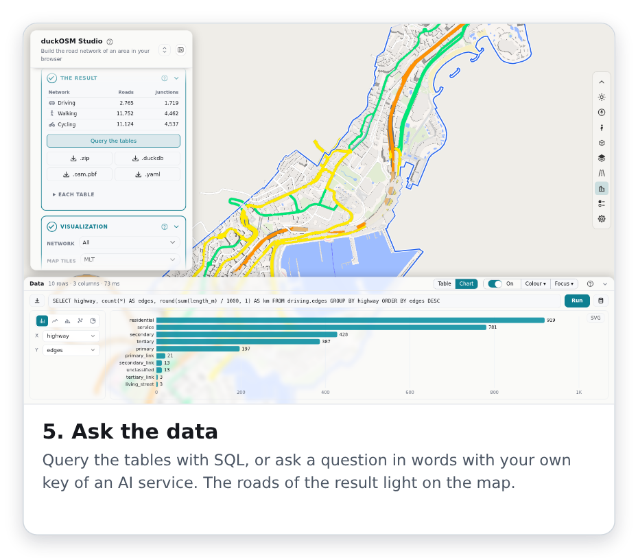
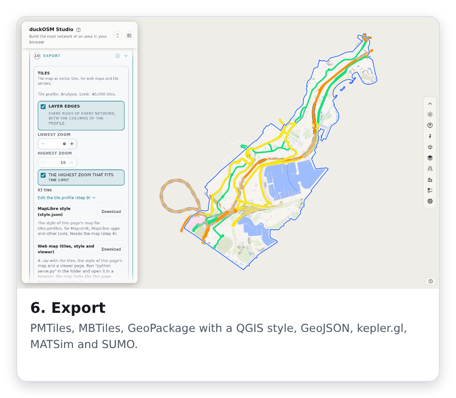

<p align="center">
  
</p>

<p align="center">
  <b>Build the road network of any area from OpenStreetMap in your browser.</b><br>
  Fix the OSM data, style the map and export the result. You install nothing.
</p>

<p align="center">
  <a href="https://github.com/Khoshkhah/duckosm-studio/actions/workflows/ci.yml"></a>
  <a href="https://github.com/Khoshkhah/duckosm-studio/actions/workflows/pages.yml"></a>
  <a href="LICENSE"></a>
</p>

<p align="center">
  <a href="https://khoshkhah.github.io/duckosm-studio/"><b>Open duckOSM Studio</b></a> ·
  <a href="https://khoshkhah.github.io/duckosm-studio/manual/"><b>Read the manual</b></a> ·
  <a href="https://khoshkhah.github.io/duckosm-studio/manual/first_map/">Make your first map</a>
</p>

### What you can do

<p align="center">
  <picture>
    <source media="(prefers-color-scheme: dark)" srcset="docs/img/cards/06b-area-on-map-dark.png">
    
  </picture>
  <picture>
    <source media="(prefers-color-scheme: dark)" srcset="docs/img/cards/12-map-after-build-dark.png">
    
  </picture>
  <picture>
    <source media="(prefers-color-scheme: dark)" srcset="docs/img/cards/20-fix-turn-dark.png">
    
  </picture>
  <picture>
    <source media="(prefers-color-scheme: dark)" srcset="docs/img/cards/32-design-dark-map-dark.png">
    
  </picture>
  <picture>
    <source media="(prefers-color-scheme: dark)" srcset="docs/img/cards/42-dock-chart-dark.png">
    
  </picture>
  <picture>
    <source media="(prefers-color-scheme: dark)" srcset="docs/img/cards/11b-export-dark.png">
    
  </picture>
</p>

The result has the same tables as [duckOSM](https://github.com/Khoshkhah/duckOSM). Each road has a stable `edge_id`: a hash of the OSM way and its two end nodes, so the same road has the same `edge_id` in each build.

### Built with

<table>
  <tr>
    <td width="72" valign="middle"><a href="https://github.com/Khoshkhah/duckOSM"></a></td>
    <td width="42%" valign="middle"><b><a href="https://github.com/Khoshkhah/duckOSM">duckOSM</a></b><br>The Rust engine that builds the networks from OpenStreetMap data, and the fixes editor of card 7.</td>
    <td width="72" valign="middle"><a href="https://github.com/Khoshkhah/roadstyle"></a></td>
    <td width="42%" valign="middle"><b><a href="https://github.com/Khoshkhah/roadstyle">roadstyle</a></b><br>The map and the dashboard: the panel, the bar of tools, the level editor, the design panel, the data dock and Ask.</td>
  </tr>
</table>

Studio has no engine and no map code of its own. It uses the two projects as libraries, each at one pinned version: the duckOSM `rev` in `crates/duckosm-wasm/Cargo.toml` and `ROADSTYLE_COMMIT` in `crates/duckosm-wasm/build.sh`. To get a change from one of them, merge it there and move the pin here.

Other parts: [MapLibre GL JS](https://maplibre.org/) draws the map, [DuckDB](https://duckdb.org/) (duckdb-wasm) holds the tables in the browser, and [OpenFreeMap](https://openfreemap.org/) gives the base map. The data is © [OpenStreetMap contributors](https://www.openstreetmap.org/copyright) (ODbL).

### Run it yourself

You need Rust, `wasm-bindgen-cli` and the nightly toolchain that [docs/development.md](docs/development.md) names.

```bash
CARGO_BUILD_JOBS=4 ./crates/duckosm-wasm/build.sh
python3 crates/duckosm-wasm/www/serve.py 8000
```

Open <http://localhost:8000/index.html>. `serve.py` sends the headers that WebAssembly threads need.

### How it is built

- The page is static: `index.html` and ES modules in `crates/duckosm-wasm/www/`. It needs no server.
- The Rust engine of duckOSM is compiled to WebAssembly (`crates/duckosm-wasm`). Each row of each table is equal to the duckOSM output, and a test checks it.
- DuckDB in the browser holds the tables. The page saves each build in the browser, so **Your areas** opens it again.
- roadstyle makes the vector tiles in a worker, and MapLibre draws them.
- GitHub Pages deploys the page and the [manual](https://khoshkhah.github.io/duckosm-studio/manual/) from `main`.

[docs/development.md](docs/development.md) tells how to build and test it.

### Documents

- [The manual](https://khoshkhah.github.io/duckosm-studio/manual/): every step, every editor, every export and every table.
- [Development](docs/development.md)
- [Changelog](CHANGELOG.md)

### License

[MIT](LICENSE)
