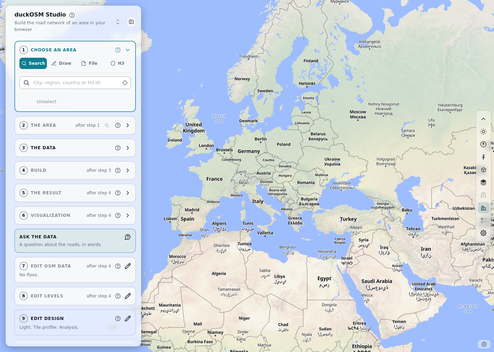
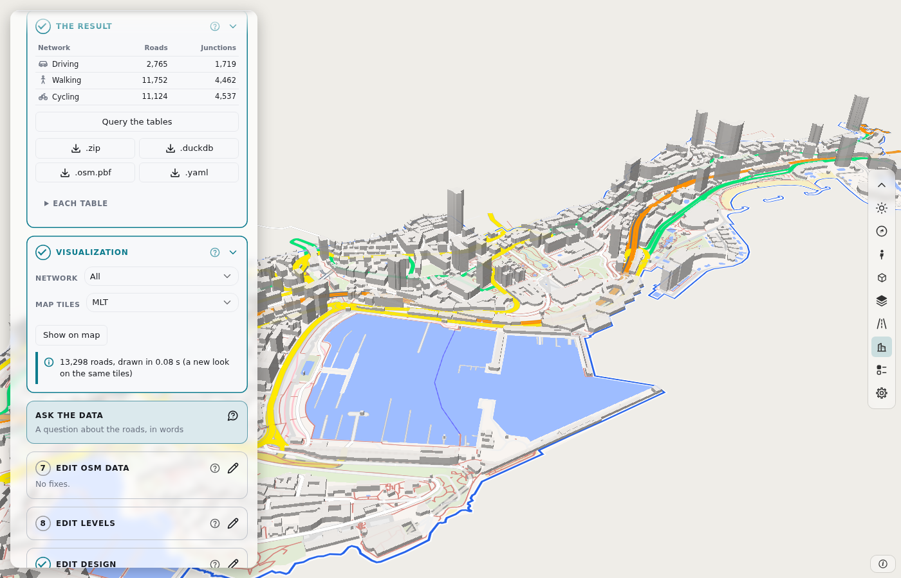
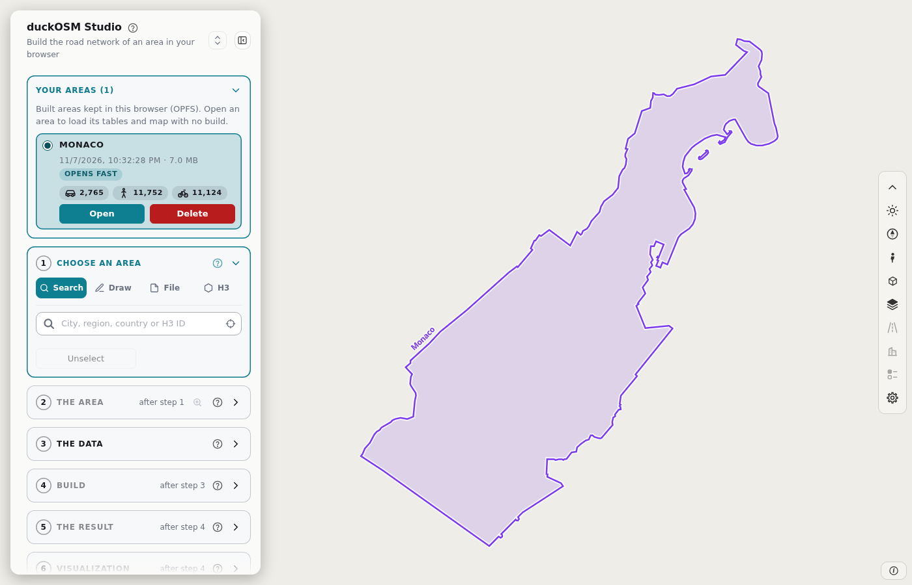
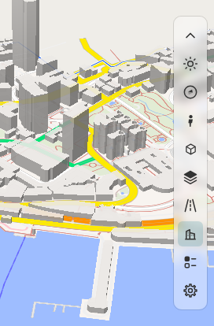
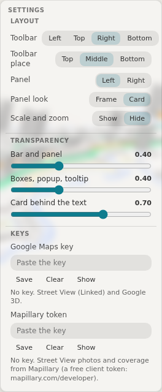
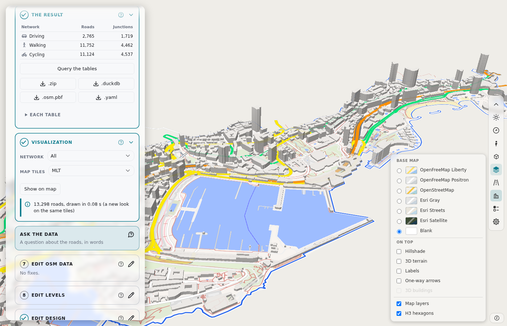
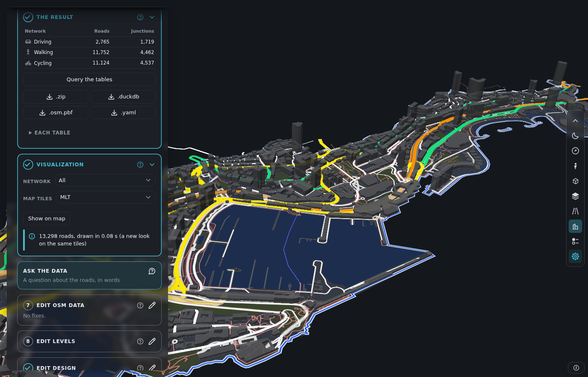
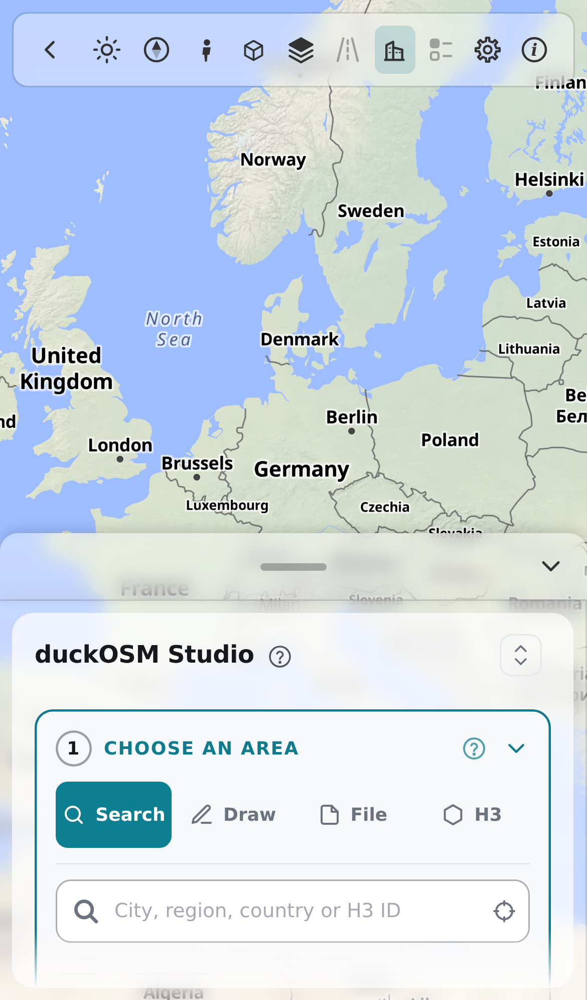

# The page

## The parts of the window

| Part | Where | What it holds |
|---|---|---|
| The map | The whole window | The base map, your area, and the roads after a build. |
| The panel | Left. On a phone, a sheet at the bottom. | **Your areas** and the cards of steps 1 to 10. |
| The bar of tools | Right | The map tools. |

A card is gray until the card before it is ready. The **?** button opens its help. A check mark shows a step that is done. Cards 7, 8 and 9 open a panel. Press **Steps** to go back.

## Your areas

The page saves each build in your browser.

- Click a row to show or hide its boundary.
- Press **Open** to load the area with no new build.
- Press **Delete** two times to delete the area.

A saved area keeps the tags of the buildings and the other map features. So you can edit them in [step 7](manual/edit-osm.md) after **Open**. The files that you download have no tags column.

**Opens fast** shows that the drawing of the roads is saved too. If you clear the site data, the saved areas go.

## The bar of tools

| Tool | What it does |
|---|---|
| Chevron | Folds the bar. |
| Sun or moon | Changes between the light and the dark theme. |
| Compass | Zooms. Press Ctrl and drag on the map to turn and tilt it. |
| Person | Shows Street View photos of a point. |
| Cube | Opens Google 3D for a place. |
| Layers | Opens the base-map box. |
| Road | Filters the road types. It is off on this page. |
| Building | Shows the buildings in 3D. It needs the OpenFreeMap base map. |
| Colors | Colors the roads by a value. It is off on this page. |
| Gear | The settings: the layout, the transparency of the layers, and the keys for Google and Mapillary. |

The **(i)** button at the bottom right of the map shows the sources of the base maps.

Street View and Google 3D need a key. Press the gear to save your key. The deployed page has its own Google key.

## Settings

Press the gear to open the settings box.

- **Toolbar** puts the bar of tools at the left, the top, the right or the bottom of the map.
- **Toolbar place** puts the bar at the start, the middle or the end of its edge.
- **Panel** puts the panel at the left or the right.
- **Panel look** shows the panel as a frame or as a card.
- **Scale and zoom** shows or hides the scale bar and the zoom buttons.
- **Transparency** has three sliders: the bar and the panel, the boxes, the popup and the tooltip, and the card behind the text.
- **Keys** saves your Google Maps key and your Mapillary token.

The page keeps your choices in this browser.

## Choose a base map

- **Base map**: OpenFreeMap, OpenStreetMap, Esri Gray, Esri Streets, Esri Satellite or Blank.
- **On top**: Hillshade, Labels, 3D buildings and Arrows (one-way roads).
- **Map layers**: the water, land use and buildings of the build.
- **H3 hexagons**: the H3 grid.

After a build, the page shows the roads on the Blank base map. Your saved choice does not change.

## Use the dark theme or a phone

At the first visit, the page uses the theme of your system.

On a phone, drag the grip of the sheet to make it taller or shorter.

## Next

- [Steps 1 and 2](manual/area.md): choose an area.
- [When the page does not work](troubleshooting.md): the limits and the problems.
