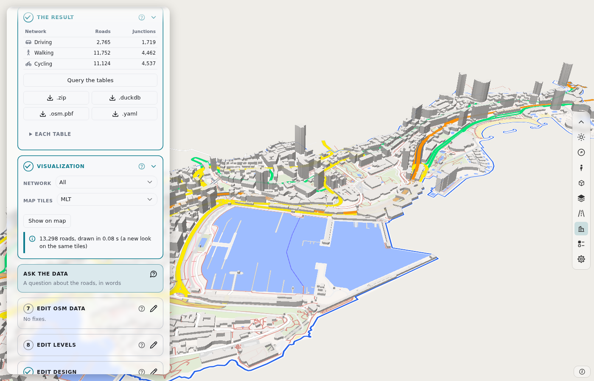

# duckOSM Studio

Build the routable road network of any area from OpenStreetMap data, in your browser.

Choose an area. The page builds the driving, walking and cycling networks. Fix the OSM data, build again, and export. The build runs in your browser.

[Open duckOSM Studio](https://khoshkhah.github.io/duckosm-studio/){ .md-button .md-button--primary }
[Make your first map](first_map.md){ .md-button }
[View on GitHub](https://github.com/Khoshkhah/duckosm-studio){ .md-button }

## What you can do

-   :material-map-search-outline:{ .lg .middle } **Choose and build**

    ---

    Search a place, draw a shape, load a file or pick H3 cells. Build the three networks.

    [:octicons-arrow-right-24: The area](manual/area.md) · [Data and build](manual/build.md)

-   :material-pencil-outline:{ .lg .middle } **Fix the OSM data**

    ---

    Change a road, a building, a node or a turn rule. Build again.

    [:octicons-arrow-right-24: Edit OSM data](manual/edit-osm.md)

-   :material-layers-outline:{ .lg .middle } **Levels and design**

    ---

    Say which bridge or road is on top. Choose a theme, or set each color and width.

    [:octicons-arrow-right-24: Edit levels](manual/edit-levels.md) · [Edit design](manual/edit-design.md)

-   :material-chat-question-outline:{ .lg .middle } **Ask the data**

    ---

    Query the tables with SQL, or ask a question in words. The roads of the result light on the map.

    [:octicons-arrow-right-24: Ask and query the data](manual/ask.md)

-   :material-export-variant:{ .lg .middle } **Export**

    ---

    PMTiles, MBTiles, GeoPackage, GeoJSON, kepler.gl, MATSim and SUMO.

    [:octicons-arrow-right-24: Export](manual/export.md)

-   :material-table:{ .lg .middle } **The tables**

    ---

    The same tables as duckOSM, with a stable `edge_id`.

    [:octicons-arrow-right-24: The tables](manual/tables.md)

## What you get

- **Nothing to install.** Open the page and start.
- **A routable network.** Each edge has a length, a speed and a travel time. The build applies the turn restrictions.
- **A stable `edge_id`.** The same road has the same `edge_id` in every build.
- **Fast.** Monaco builds in less than one second. Estonia (a 121 MB region file) builds its driving network in about 10 seconds, and it needs about 710 MiB of memory (measured on 2026-10-22; see [the design](https://github.com/Khoshkhah/duckosm-studio/blob/main/docs/design.md), section 7, "Memory and streaming").
- **The same tables as [duckOSM](https://github.com/Khoshkhah/duckOSM).**
- **A fix loop.** Change a road, a building, a node or a turn rule. Build again.
- **Ask the data.** Query the tables with SQL, or ask a question in words. The roads of the result light on the map, and the answer can be a chart.
- **Export** to PMTiles, MBTiles, GeoPackage, GeoJSON, kepler.gl, MATSim and SUMO.

## Read the manual

| Page | Use it to |
|---|---|
| [The editing cycle](manual/cycle.md) | See all the work on one picture. |
| [The page](dashboard.md) | Know the parts of the window. |
| [Steps 1 and 2](manual/area.md) | Choose the area. |
| [Steps 3 and 4](manual/build.md) | Get the data and build. |
| [Steps 5 and 6](manual/result.md) | Download the result and show the map. |
| [Step 7](manual/edit-osm.md) and [the fixes file](manual/fixes-file.md) | Fix the OSM data. |
| [Step 8](manual/edit-levels.md) | Fix bridges and tunnels. |
| [Step 9](manual/edit-design.md) | Set the look of the map. |
| [Step 10](manual/export.md) | Export the network. |
| [Ask and query the data](manual/ask.md) | Query the tables with SQL, or ask in words. |
| [The tables](manual/tables.md), [the roads](manual/roads.md), [the columns](output-tables.md) | Know what the result holds. |
| [Concepts](concepts.md) | Learn the words. |
| [Command line and Python](cli.md) | Build from a script. |

## Built on

[roadstyle](https://github.com/Khoshkhah/roadstyle) (the map and the dashboard), [duckOSM](https://github.com/Khoshkhah/duckOSM) (the engine and the fixes editor), [MapLibre GL JS](https://maplibre.org/), [DuckDB](https://duckdb.org/), [OpenFreeMap](https://openfreemap.org/) (the base map) and [OpenStreetMap](https://www.openstreetmap.org/copyright) (the data, © OpenStreetMap contributors, ODbL).
