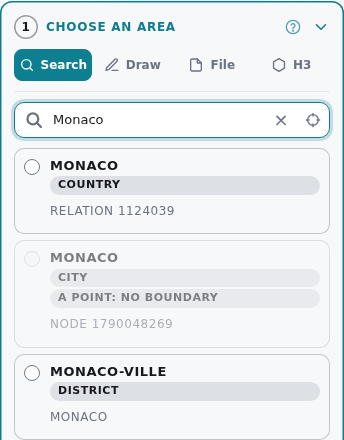
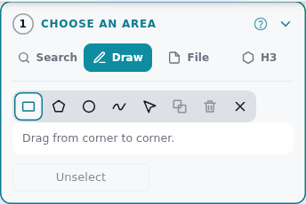
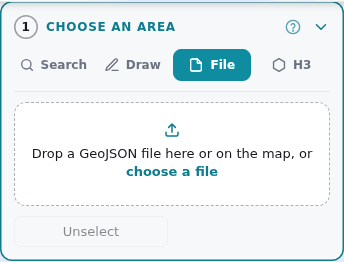
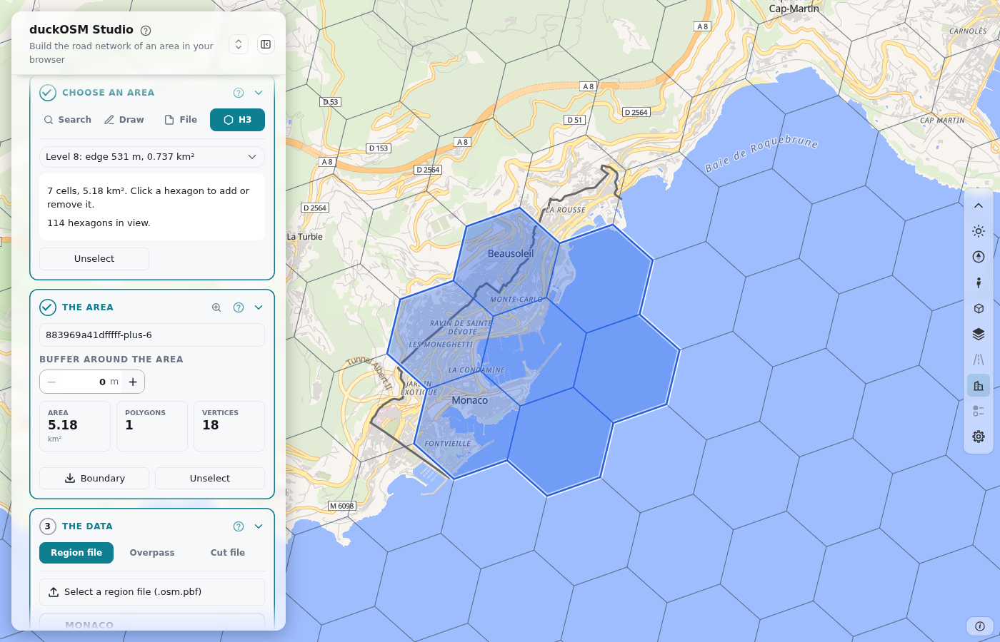
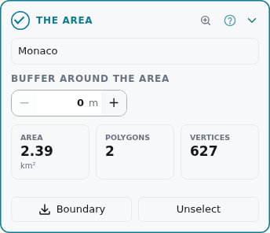
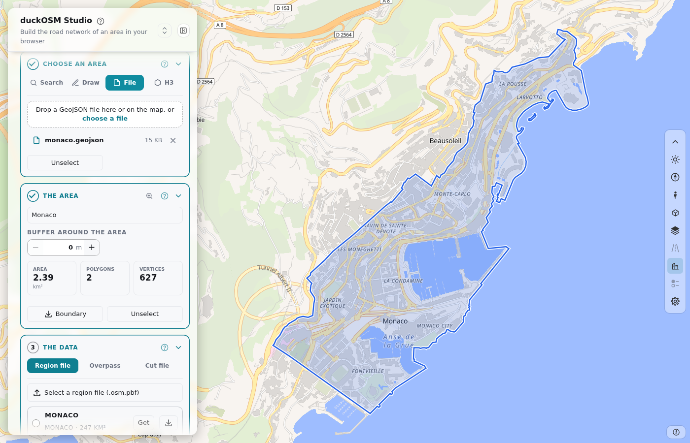

# Steps 1 and 2: The area

The area is the part of the world that you build. In step 1, you make its shape. In step 2, you name it and add a buffer.

## Step 1: Choose an area

Step 1 has four tabs. Use one of them.

### Search for a place

1. Type a city, a region or a country. The page shows up to 10 matches.
2. Click a match. The page draws its boundary.
3. To remove the area, click the match again, or press **Unselect**.

If the page cannot get the boundary, press **use the box of the place**.

To see which areas are at a point, press the target button in the search field (**What is here?**) and click a point on the map. The page lists the areas around it.

### Draw a shape

| Tool | Key | How |
|---|---|---|
| Rectangle | R | Drag from corner to corner. |
| Polygon | P | Click each corner. Press **Enter** to close the shape. |
| Circle | C | Drag from the center out. |
| Freehand | F | Drag around the area. |
| Select | S | Click a shape to move it or to change its corners. |

The other buttons of the row:

| Button | What it does |
|---|---|
| **Merge** | Joins shapes that overlap. |
| **Delete** (Delete key) | Removes the selected shape. |
| **Delete all shapes** (×) | Removes all shapes. |

### Load a file

Select a GeoJSON file (**choose a file**), or drop it on the map. The page uses every polygon in the file.

### Pick hexagons

1. Choose the [H3](https://h3geo.org) level, from 5 to 10.
2. Click a hexagon to add it. Click it again to remove it.

The area can have 500 cells and 5,000 km² at most.

## Step 2: Name the area

| Part | What it does |
|---|---|
| **Name** | The name of your files and of the saved area. |
| **Buffer around the area (m)** | Makes the area larger on all sides, from 0 to 50,000 m. Use − and +, or type a number. |
| The zoom button | Zooms the map to the area. |
| The numbers | The **Area** in km², the number of **Polygons** and the number of **Vertices**. |
| **Boundary** | Downloads the area as `boundary.geojson`. |
| **Unselect** | Removes the area. |

The area shows on the map in blue:

## Next

[Steps 3 and 4](build.md) get the data and build the network.
