# Step 9: Edit design

Card 9 sets the look of the map and the tile profile. You can use it at all times, also before a build. Click the card to open the panel. The panel is the design panel of [roadstyle](https://github.com/Khoshkhah/roadstyle).

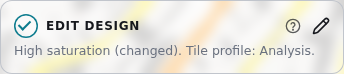

- **Steps** goes back to the steps.
- **Hide panel** gives the map the full width.

A change shows on the map after half a second. The bar at the bottom of the panel says "The map shows this design" when the map is ready.

| Tab | What it sets |
|---|---|
| **Theme** | The ready themes, your own themes, and the design file. |
| **Roads** | The colors, widths and opacity of the roads. |
| **Bridges & tunnels** | The casing and shadow of the bridges, and the colors of the tunnels. |
| **Text** | The street names and the one-way arrows. |
| **Layers** | The layers on the map, the area boundary, the ground, the base-map colors, the 3D buildings and the 3D walls. |
| **Tiles** | The tile profile of the export files. |

## Choose a theme

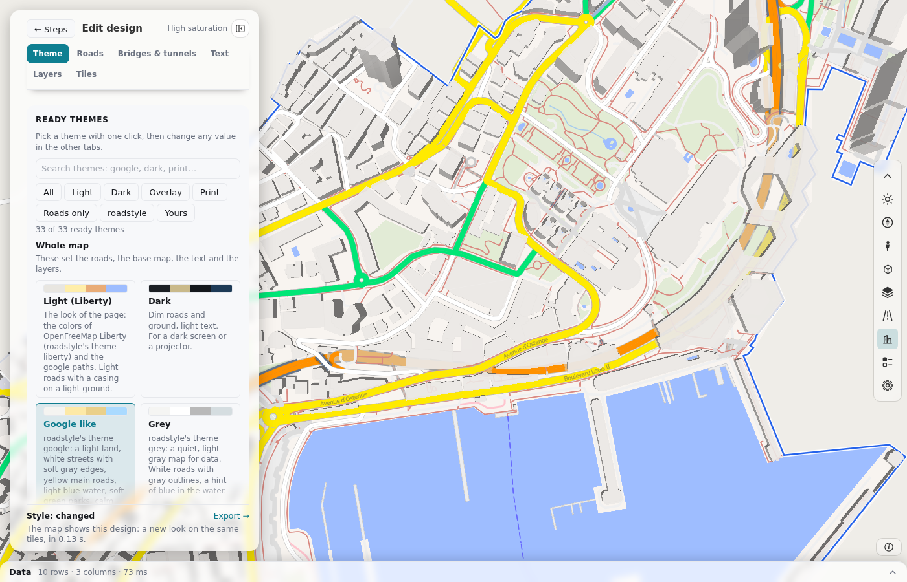

A theme sets all the colors and widths of the map. It keeps your tile profile.

1. Type words in **Search themes**, or press a filter: **All**, **Light**, **Dark**, **Overlay**, **Print**, **Roads only**, **roadstyle** or **Yours**.
2. Click a theme.
3. To change a value, use the other tabs. The design then shows as "custom".

**Preview on** changes only the map under the roads: **Checkerboard**, **Blank**, **OpenFreeMap** or **Satellite**.

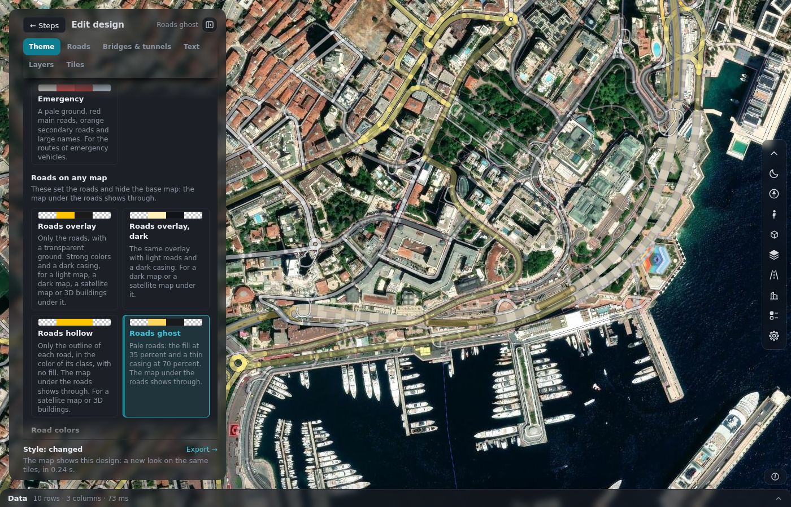

The **Overlay** themes show only the roads, on a transparent ground. Use them on a satellite map or another base map.

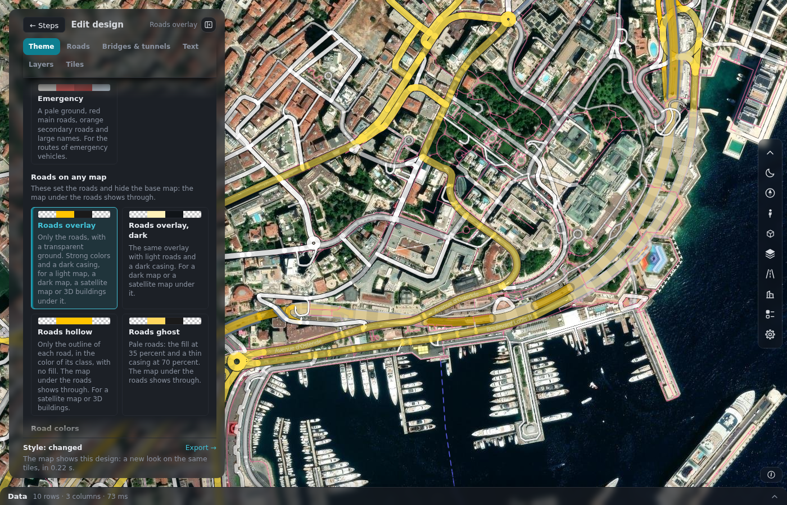

## Save your own theme

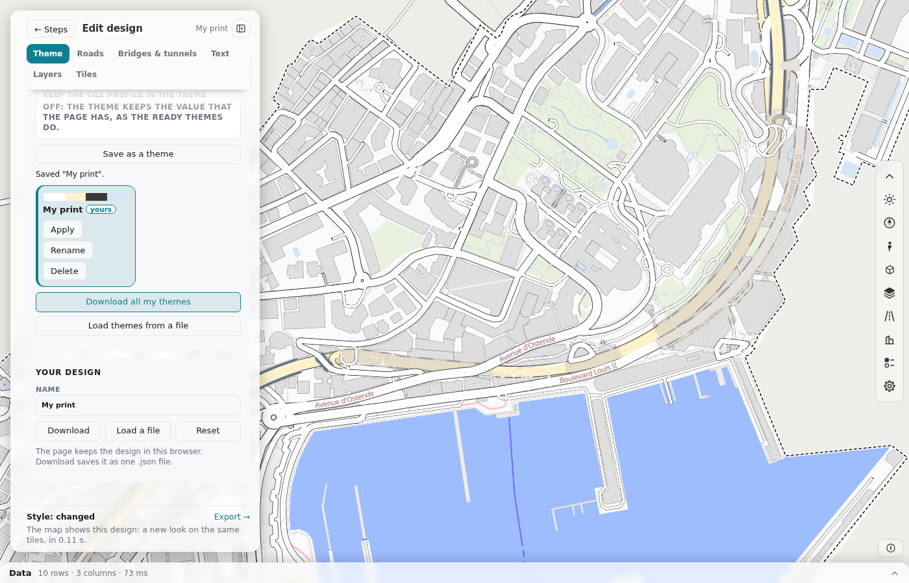

1. Pick a ready theme and change it.
2. In **Your themes**, type a name.
3. Press **Save as a theme**.

Your theme then has the buttons **Apply**, **Rename** and **Delete**. To keep more changes in it, press **Update "Name"**.

Your themes stay in this browser. To move them to another computer, use **Download all my themes** and **Load themes from a file**.

## Save the design as a file

- **Download** saves the design as a `.design.json` file.
- **Load a file** reads such a file.
- **Reset** goes back to the Light style and keeps the tile profile.

The page also keeps the last design in this browser, and with each saved area.

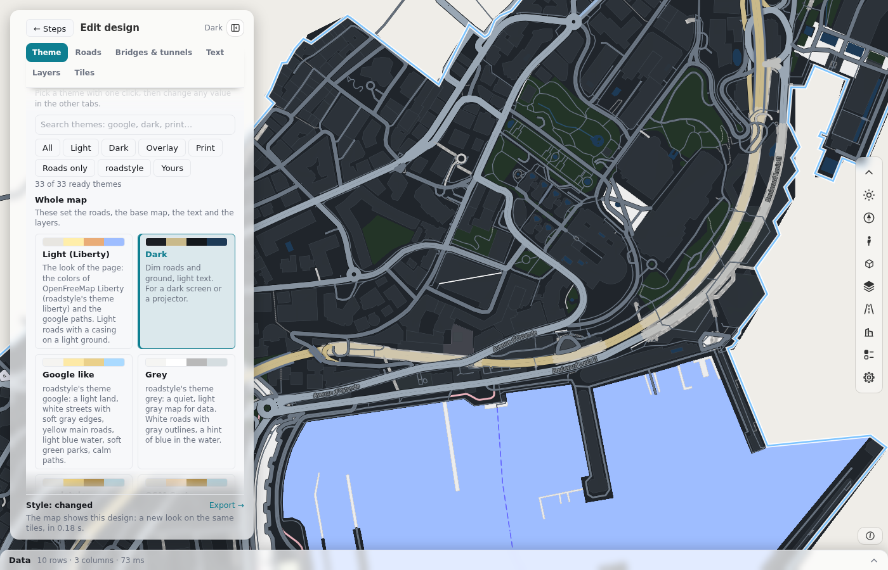

## Change the roads

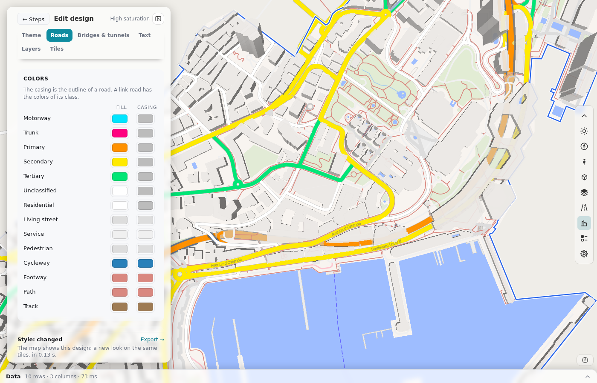

- **Colors.** A fill color and a casing color for each road class. The casing is the outline of the road.
- **Width.** A factor for each group of classes. A factor of 2 doubles the width. [The roads on the map](roads.md#the-roads-on-the-map) lists the classes of each group.
- **Opacity.** **Fill opacity** and **Casing opacity**. A lower value lets the map under the roads show through.
- **Casing as an outline.** Turn it on when the fill is not opaque.
- **Dark mode.** How light the colors of the dark theme are (0 is black, 1 is white).

## Change bridges and tunnels

- **Bridges.** The casing color and the casing width (a factor of the casing width of the theme). A **Shadow** with its color, opacity and blur shows the bridge above the roads under it.
- **Tunnels.** **Strength** (0 % keeps the colors of the road, 100 % gives the full tunnel colors), **Colors toward**, **Dash colors**, and **Dash and gap**. The Tunnels box of the bar of tools has the same controls.

If the map has no bridge or no tunnel, the tab says so.

## Change the text

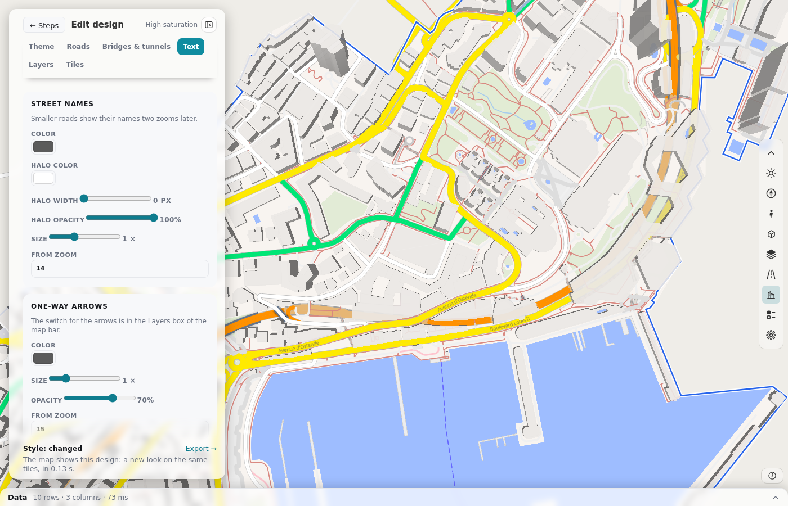

- **Street names.** Color, halo, size and first zoom.
- **One-way arrows.** Color, opacity, size and first zoom.

## Change the layers

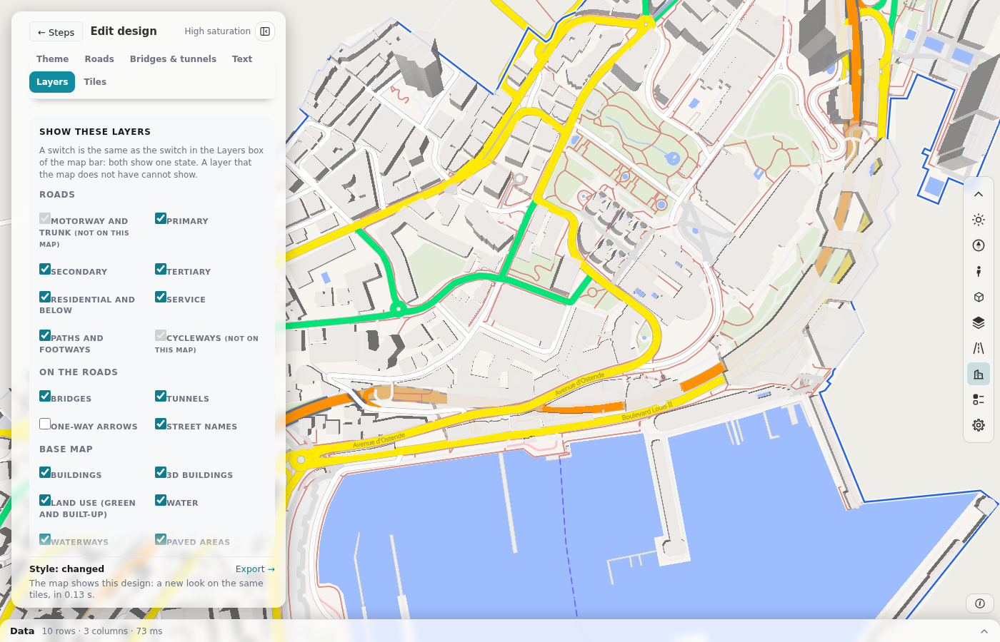

- **Show these layers.** One switch for each layer.
- **Area boundary.** The color, width, line style and fill of the line around your area.
- **Ground.** **Transparent ground** and its opacity.
- **Base-map colors.** One color for each group, for example water or buildings.
- **3D buildings.** The height of a floor, the highest building and the opacity.
- **3D walls.** Turn on **Walls by type**. Each wall of a building then has the color of its type, and the roof has its own color. You can set the color of **Front**, **Back**, **Side**, **Party wall** and **Courtyard wall**, and of the **Roof** for the light and for the dark theme. The colors are the same as the wall colors of [step 7](edit-osm.md#fix-a-building). The walls show while the 3D buildings show. Tilt the map to see them. A building with no wall types keeps its color. This switch is off at the start. The walls need a build with **Layers** on.

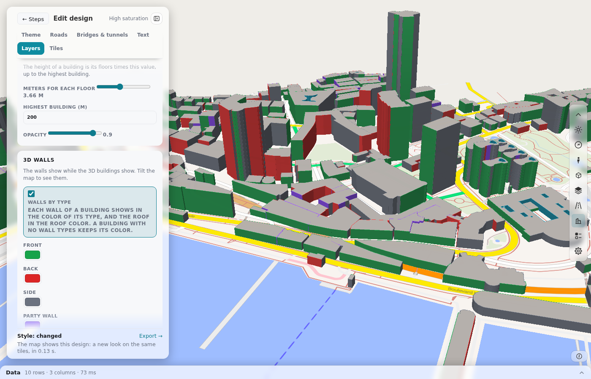

If the build does not have a layer, the layer shows "(not in this build)".

## Tiles

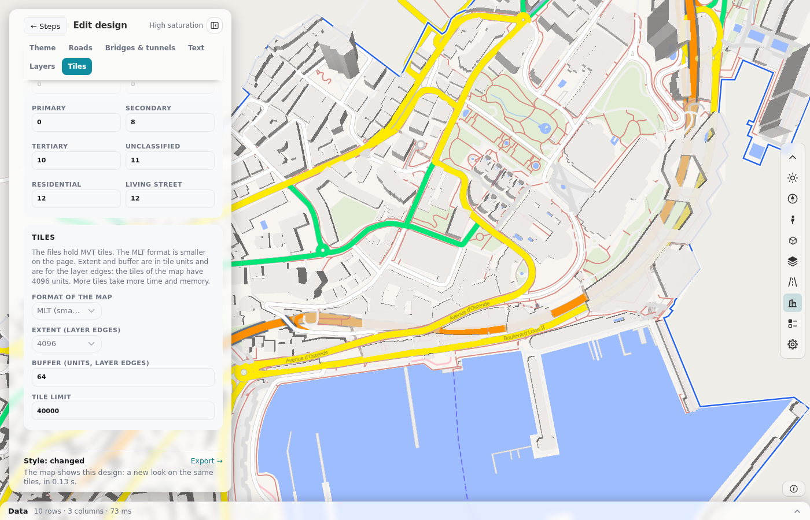

The tile profile sets what the tile files of [step 10](export.md) hold. Click a ready profile:

| Profile | What the files hold |
|---|---|
| **Web map small** | Zoom 0 to 14. The roads and the base map. A small file. |
| **Analysis** | The roads, the base map and the layer `edges` with all columns. This is the default. |
| **Roads only** | The roads and the layer `edges`. No base map. |
| **Simulation preview** | From zoom 10. The roads and the layer `edges` with the columns that a simulation needs. |

You can also change each field:

- **Zoom.** The lowest and the highest zoom. **The highest zoom that fits the limit** finds the highest zoom for you.
- **Layers in the files.** **Roads**, **Base map** and **Layer edges**.
- **Extent** and **Buffer** of the layer `edges`, in tile units.
- **Columns of the layer edges.** `edge_id` is always in the layer.
- **Road class start zoom.** The first zoom of each road class in the layer `edges`.
- **Format of the map.** MLT (smaller) or MVT. The tile files always hold MVT.
- **Tile limit.** The largest number of tiles in a file, from 1,000 to 200,000.

## Next

Go to [step 10](export.md) to export the network and the tiles.
