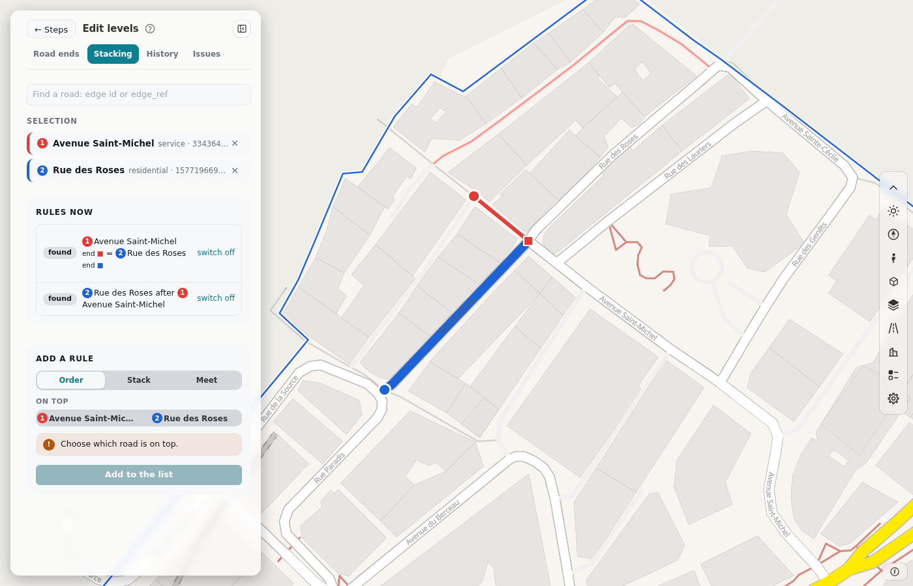
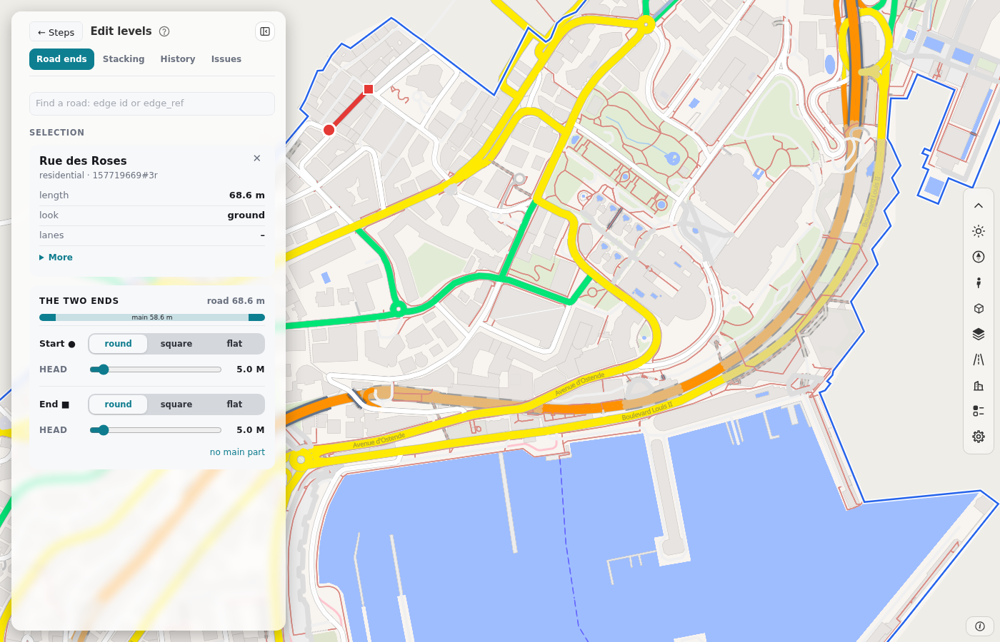
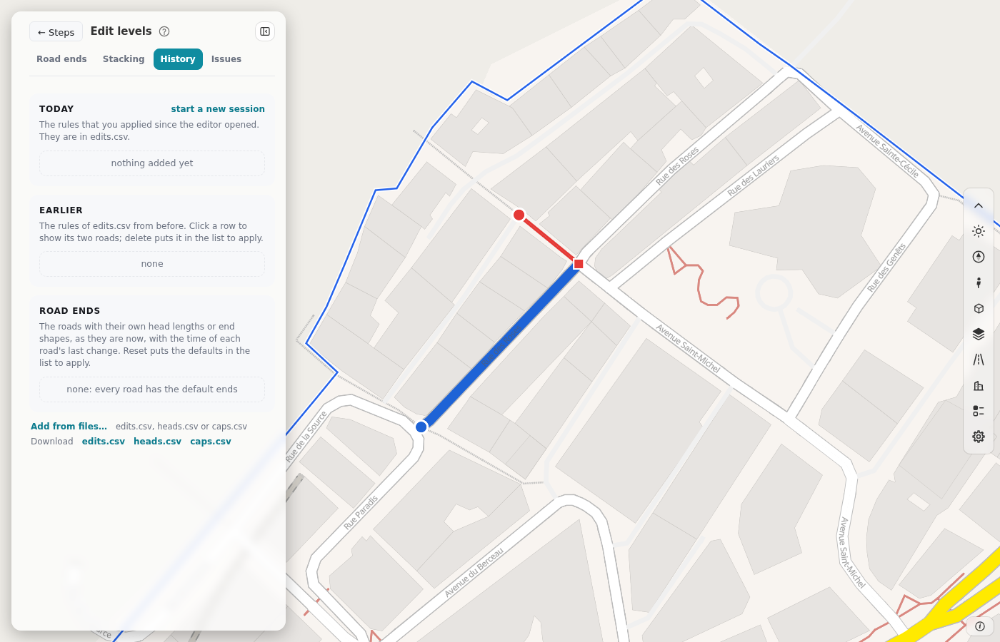
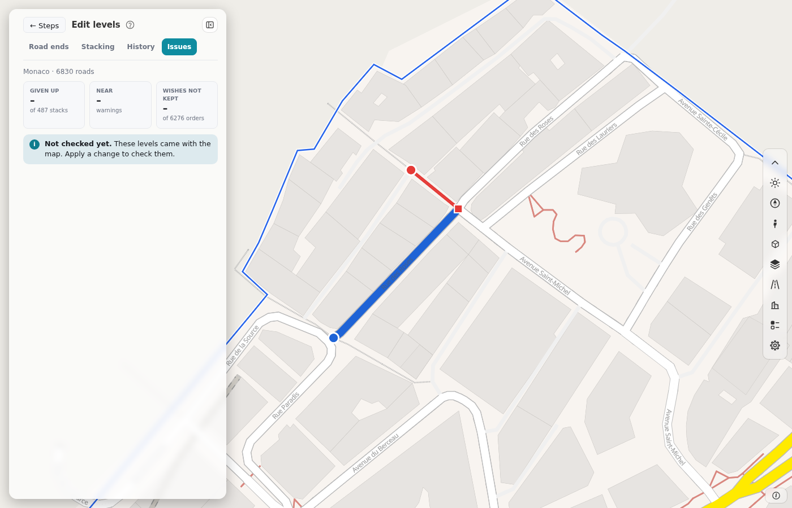

# Step 8: Edit levels

Use card 8 when the wrong road is on top where two roads cross or meet, or when the end of a road looks wrong. The card opens the level editor of [roadstyle](https://github.com/Khoshkhah/roadstyle) in a panel. The card needs a build.

## What a level is

Each edge has a level for its outline (the casing) and a level for its fill. A bridge has a higher level than the road under it. The map draws the lowest level first. The build finds the levels from the OSM tags and the road class. The editor does not change the OSM data. It changes only the drawing order and the shape of the road ends. [levels.md](https://github.com/Khoshkhah/duckosm-studio/blob/main/docs/levels.md) has the method.

## The panel

The panel has four tabs. Press **← Steps** to go back to the steps. The **?** button explains each part.

| Tab | What it is for |
|---|---|
| **Road ends** | One road: the shape and the head length of each end. |
| **Stacking** | Two roads: the rules between them. |
| **History** | Your rules, with their times. |
| **Issues** | What the solver could not keep. |

At the top of **Road ends** and **Stacking**, type an `edge_id` or an `edge_ref` in **Find a road**. If the panel shows check boxes for the modes, use them to show only the roads of some modes. This changes only what you see. The solver always uses all roads.

## Pick a road

Click a road on the map. It is **road 1** (red). The **Selection** shows its name and class, its length, its look (for example ground, bridge or tunnel) and its lanes. Open **More** for the road id, the directions, the modes and the four levels. To remove a road from the selection, press ✕ on its card. The **Esc** key clears the selection.

## Change the end of a road

A road has a start (●) and an end (■). Each end has a head: the short part of the casing at the end of the road.

1. Pick a road.
2. In **Road ends**, choose the shape of the **Start** and of the **End**: **round**, **square** or **flat**.
3. Move the **head** slider of each end. The strip over the sliders shows the start head, the main part and the end head. The two heads cannot be longer than the road.
4. Press **no main part** to give all of the road to the two heads.

The map shows the change at once. The change waits in a list (see [Apply the changes](#apply-the-changes)). An end with a waiting change has an orange mark. If you changed the heads of a road, **default lengths** gives them back.

## Add a rule between two roads

1. Pick road 1. Then pick road 2: click a second road on the map, or click a row in **Rules now**. The two roads show on the map as red and blue.
2. Open the tab **Stacking**. **Rules now** lists the rules between the two roads. A row with **found** is a rule that the build found. Click a row to show its roads on the map. **switch off** switches a found rule off.
3. In **Add a rule**, choose the kind:

    | Rule | What it says |
    |---|---|
    | **Order** | Which road is on top where the two roads meet. Choose it in **on top**. |
    | **Stack** | One road crosses over the other. Choose the road that is on top, and the parts of its casing that cross: **whole**, **start**, **main** or **end**. |
    | **Meet** | The two roads join end to end, with no ring. Choose the end of each road: **start** or **end**. |

4. The text under the choices says what the rule does. Press **Add to the list**.

A stack wins over an order. If you ask for an order that a stack already contradicts, the page tells you to switch the stack off first.

If the new rule makes a loop (A over B, B over C and C over A), the page shows the rules of the loop. The solver then gives one of them up. Press **Add anyway** to add it, or **Cancel**. If the rule is already in the list, the page says so.

To replace a stack that the build found, **switch off** its rows and then add your own parts.

## Apply the changes

Your changes wait in a list. The bar at the bottom of the panel shows how many wait (**waiting**). Press the number to see them.

| Button | What it does |
|---|---|
| **Apply and solve** | Solves all the waiting changes and draws the changed roads again. If the solver refuses them, the page saves nothing. |
| **Discard** | Removes the waiting changes. |

If you press **← Steps** while changes wait, the panel asks: **Apply**, **Discard** or **Stay**.

## Look at your rules

Open **History**.

- **Today** lists the rules that you applied since the editor opened. **start a new session** moves them to **Earlier** and starts an empty list. Nothing is deleted.
- **Earlier** lists the rules from before. Click a row to show its two roads. **delete** puts the removal of the rule in the list that waits.
- **Road ends** lists the roads that have their own head lengths or shapes, with the time of the last change. **reset** puts the default ends in the list that waits.
- **Add from files…** reads your own `edits.csv`, `heads.csv` or `caps.csv` into the list that waits.
- **edits.csv**, **heads.csv** and **caps.csv** download your rules, your head lengths and your end shapes.

## Check the result

Open **Issues** after **Apply and solve**. Before the first solve, the tab says that the levels came with the map.

| Number | What it counts |
|---|---|
| **Given up** | The crossings that the solver could not keep. Each one is a flaw on the map. |
| **Near** | The roads that only come near the road below them. Look only where the two overlap. |
| **Wishes not kept** | The orders that a stack or another order won. |

Press a number to go to its list. Click a row of a list to show its two roads in **Stacking**. If there is no issue, the tab says "No issues".

## Keep your changes

- If the area is saved, the browser keeps your rules for the next visit.
- If the area is not saved, the rules go away when you close the page. Download the three files in **History** to keep them.
- After **Apply and solve**, the tables have your result: `visualization.edge_levels`, and your rules in `visualization.level_edits`, `level_heads` and `level_caps` ([The tables](tables.md#the-drawing-order)). The exports use them.

## Next

Go to [step 9](edit-design.md) to set the look of the map, or [step 10](export.md) to export.
